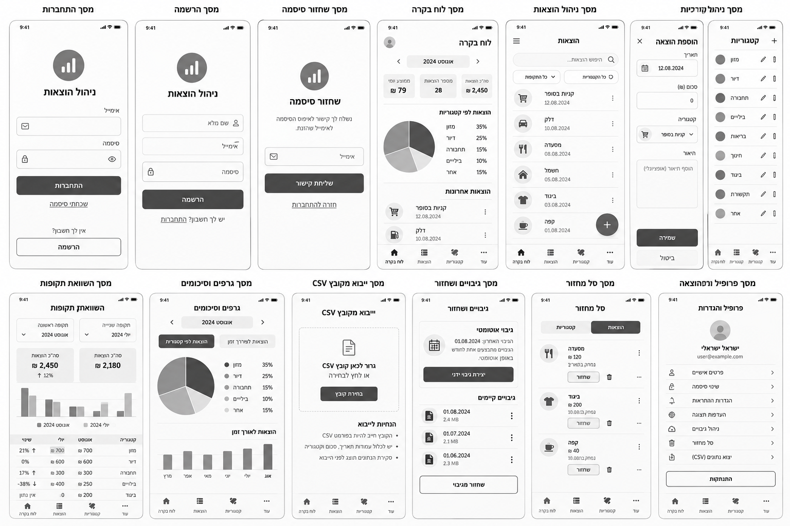
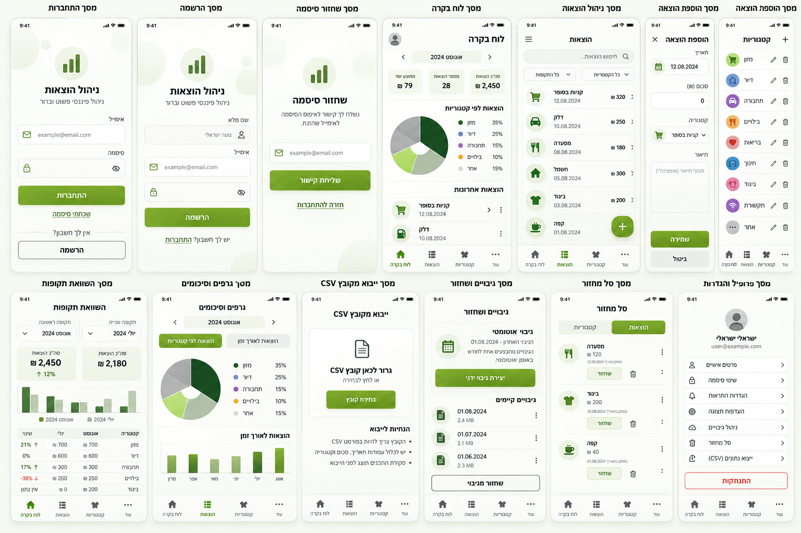
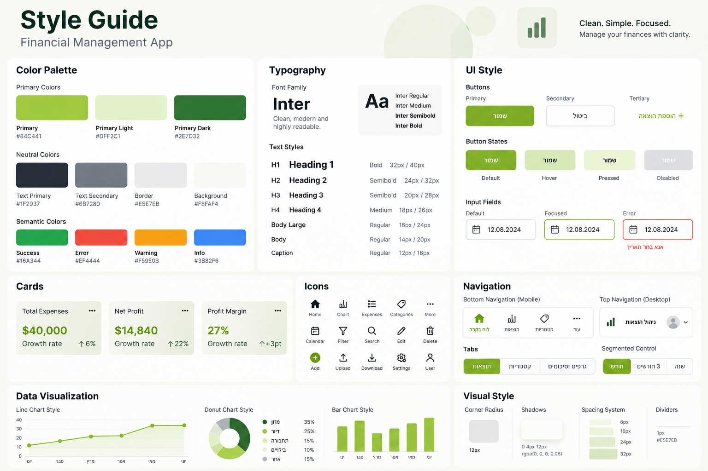

# DESIGN – מערכת לניהול הוצאות הבית

מסמך זה מתאר את מימוש ממשק המשתמש על בסיס `PRD.md`, תמונת ה-Wireframes, ה-Style Guide וה-Mockups. ה-PRD הוא המקור המחייב להתנהגות ולתכולת המוצר; התמונות משמשות מקור למבנה ולמראה בלבד. הממשק בעברית, בכיווניות RTL, ומתאים למובייל ול-Desktop.

## 1. Screens – מסכי האפליקציה

### מקורות חזותיים

**Wireframes – מבנה המסכים:**

**Mockups – המראה החזותי המיועד:**

### 1.1 מסך התחברות
- **מטרה:** כניסה למערכת הפרטית באמצעות הסיסמה המשפחתית המשותפת.
- **מבנה ותוכן:** אזור מיתוג ממורכז, שדה סיסמה, כפתור ״התחברות״ וקישור ״שכחתי סיסמה״. שפת העיצוב כוללת רקע בהיר, שדה תחום וכפתור ראשי ירוק.
- **פעולות וניווט:** כניסה מוצלחת אל ״לוח בקרה״; קישור לשחזור סיסמה. **התאמה מחייבת ל-PRD:** שדה Email והקישור ״הרשמה״ המופיעים בהדמיה אינם חלק מהכניסה בפועל, משום שאין חשבונות משתמשים נפרדים.

### 1.2 מסך שחזור סיסמה
- **מטרה:** בקשת קישור לשחזור הסיסמה המשותפת.
- **מבנה ותוכן:** כותרת ״שחזור סיסמה״, הסבר קצר, כתובת השחזור המוגדרת מוצגת כטקסט במיסוך חלקי (למשל ״הקישור יישלח אל `e***@gmail.com`״), כפתור ״שליחת קישור״ וקישור ״חזרה להתחברות״. **אין שדה להזנת Email** (בשונה מההדמיה), כי קיימת כתובת שחזור אחת בלבד. לאחר השליחה מוצגת הודעת אישור.
- **פעולות וניווט:** בקשת קישור וחזרה למסך ההתחברות; קביעת סיסמה חדשה מתבצעת באמצעות קישור השחזור, ללא חשבון אישי.

### 1.3 לוח בקרה
- **מטרה:** הצגת תמונת מצב מיידית של הוצאות החודש הנוכחי.
- **מבנה ותוכן:** כותרת ״לוח בקרה״, שם החודש הנוכחי (ללא חיצי מעבר בין חודשים), כרטיס אחד של סך ההוצאות, גרף Donut לפי קטגוריות, רשימת חמש ההוצאות האחרונות וכפתור הוספת הוצאה. **הכרעת PRD:** כרטיסי ״מספר הוצאות״ ו״ממוצע יומי״, חיצי החודש ואוואטר המשתמש שבהדמיה אינם חלק מהמימוש. במובייל הרכיבים מסודרים אנכית; ב-Desktop לפי ״פריסת Desktop״ למטה.
- **פעולות וניווט:** מעבר להוצאות, לסיכומים ולפעולת הוספת הוצאה; לחיצה על הוצאה אחרונה פותחת את טופס העריכה שלה.

### 1.4 מסך ניהול הוצאות
- **מטרה:** עיון וניהול ההוצאות הפעילות.
- **מבנה ותוכן:** כותרת ״הוצאות״, כפתור ״ייצוא CSV״ בכותרת המסך, אזור מסננים (טווח תאריכים מ–עד, קטגוריה אחת או ״כל הקטגוריות״), פקדי מיון (תאריך/סכום, עולה/יורד), רשימת הוצאות, Pagination וכפתור הוספה צף. הרשימה מציגה 20 פריטים בעמוד.
- **שורת הוצאה:** טקסט ראשי = התיאור, ואם אין – שם הקטגוריה; מתחתיו התאריך (`DD.MM.YYYY`); סמן צבע הקטגוריה ושמה; הסכום בצד השמאלי; תפריט ״⋮״ עם ״שכפול״ ו״מחיקה״. אין אייקון קטגוריה.
- **פעולות וניווט:** לחיצה על שורה פותחת את טופס העריכה (הצפייה בפרטים נעשית בטופס). ״מחיקה״ מעבירה לסל המחזור **ללא חלון אישור**, עם הודעת הצלחה. ״ייצוא CSV״ פותח חלון בחירה: ״כל ההוצאות״ או ״לפי הסינון הנוכחי״.
- **הערת התאמה:** שדה חיפוש טקסט חופשי ותפריט ההמבורגר שבתמונות אינם דרישה מאושרת ולכן לא ייושמו.

### 1.5 מסך הוספה ועריכת הוצאה
- **מטרה:** יצירת הוצאה, עדכון הוצאה קיימת או יצירת עותק מתוך הוצאה קיימת.
- **מבנה ותוכן:** כותרת ״הוספת הוצאה״ (או ״עריכת הוצאה״), שדה תאריך, שדה סכום (₪), בחירת קטגוריה, שדה תיאור אופציונלי, כפתור ״שמירה״ ופעולת ״ביטול״. סדר השדות ויישורם RTL; שדות המספר והתאריך נשארים קריאים לפי כיווניות התוכן. התאריך מוצג בפורמט `DD.MM.YYYY`, ברירת המחדל בהוספה היא היום, ובורר התאריך אינו מאפשר תאריך עתידי. בבחירת הקטגוריה מוצגים שם וסמן צבע.
- **פעולות וניווט:** שמירה וחזרה לרשימה; ביטול; אזהרה בעת יציאה עם שינויים שלא נשמרו. השכפול משתמש באותו טופס עם ערכים שהועתקו, ולא במסך נוסף.

### 1.6 מסך ניהול קטגוריות
- **מטרה:** צפייה וניהול של כל הקטגוריות, גם ללא הוצאות.
- **מבנה ותוכן:** כותרת ״קטגוריות״, פעולת הוספה, רשימה של שמות קטגוריות עם סמן צבע עגול ופעולות עריכה ומחיקה. **הכרעת PRD:** אין אייקון לקטגוריה (בשונה מההדמיה); הצבע מוצג כנקודה עגולה לצד השם.
- **פעולות וניווט:** הוספה ושינוי שם/צבע – הצבע נבחר מתוך 12 צבעי פלטת הקטגוריות (סעיף 2.1) כרשת עיגולים; מחיקה; במקרה של קטגוריה עם הוצאות – בחירת קטגוריה חלופית לפני אישור המחיקה. כשנותרה קטגוריה אחת בלבד, פעולת המחיקה שלה מושבתת עם הסבר. טפסי הפעולה ואישורים הם מצבים של המסך, לא מסכים חדשים. המסך נגיש ממסך ״עוד״.

### 1.7 מסך השוואת תקופות
- **מטרה:** השוואה בין שתי תקופות שנבחרו ידנית.
- **מבנה ותוכן:** שני בוררי תקופות בתוויות ״תקופה א׳ (בסיס)״ ו״תקופה ב׳״, כרטיסי סיכום כספי, גרף עמודות להשוואה וטבלת קטגוריות המציגה סכומים והפרשים. ההפרש והאחוז מחושבים כ״תקופה ב׳ ביחס לתקופה א׳״, וכך גם מנוסח בכותרת עמודת ״שינוי״. המסך נגיש מכפתור ״השוואת תקופות״ במסך הסיכומים וממסך ״עוד״. שימוש בירוקים ובגוונים ניטרליים כדי להבחין בין התקופות, עם מקרא ברור שאינו מסתמך על צבע בלבד.
- **פעולות וניווט:** שינוי כל אחת מהתקופות וצפייה בהשוואה המעודכנת. קטגוריה שהופיעה בתקופה אחת בלבד מוצגת עם ₪0 בתקופה האחרת; כשבסיס ההשוואה הוא אפס מופיע ״אין נתון להשוואה״ במקום אחוז.

### 1.8 מסך גרפים וסיכומים
- **מטרה:** ניתוח הוצאות לפי תקופה וקטגוריה.
- **מבנה ותוכן:** כותרת ״גרפים וסיכומים״, בקר מקטעים (Segmented Control) לסוג התקופה – יום, שבוע, חודש, שנה, טווח מותאם – ובורר תקופה עם חצים לתקופה הקודמת/הבאה (לא מעבר לתקופה עתידית); כרטיס סכום כולל; Donut עם Legend; טבלת קטגוריות עם סכום ואחוז; כפתור ״השוואת תקופות״. שמות הקטגוריות והסכומים מוצגים בסמוך לצבעיהם.
- **פעולות וניווט:** בחירת סוג ותקופה; שינוי התצוגה בהתאם לנתונים. רק קטגוריות עם הוצאות בתקופה שנבחרה מוצגות בגרף ובטבלה.
- **הכרעת PRD:** הלשוניות ״הוצאות לפי קטגוריה / הוצאות לאורך זמן״ וגרף ״הוצאות לאורך זמן״ שבהדמיה אינם חלק מהמימוש.

### 1.9 מסך ייבוא מקובץ CSV
- **מטרה:** קליטת הוצאות מקובץ לאחר בדיקת הנתונים.
- **מבנה ותוכן:** כותרת ״ייבוא מקובץ CSV״, אזור בחירת קובץ, כפתור ״בחירת קובץ״ והנחיות קצרות: עמודות נדרשות (תאריך, סכום, קטגוריה, תיאור), פורמט תאריך `YYYY-MM-DD`, גודל מרבי 2MB. לאחר בחירה, אותו מסך מכיל בדיקת שורות, תיקון שגיאות, טיפול בכפילויות ומיפוי קטגוריות בהתאם ל-PRD.
- **פעולות וניווט:** בחירת קובץ, בדיקתו, תיקון שורות ואישור ייבוא; הצגת שורות שנכשלו ואפשרות לניסיון חוזר. אין ליצור מסך נפרד לכל מצב של הייבוא.

### 1.10 מסך גיבויים ושחזור
- **מטרה:** צפייה בגיבויים קיימים וביצוע שחזור מלא מבוקר.
- **מבנה ותוכן:** כותרת ״גיבויים ושחזור״, כרטיס ״גיבוי אוטומטי״ עם מועד הגיבוי האחרון, רשימת גיבויים לפי תאריך ופעולת ״שחזור מגיבוי״. ברשימה מופיעים גם גיבויי בטיחות, עם תגית ״גיבוי בטיחות לפני שחזור״ ומועד המחיקה האוטומטית שלהם.
- **פעולות וניווט:** בחירת גיבוי, אישור שחזור וצפייה במצב הפעולה. **הכרעת PRD:** גיבוי ידני אינו חלק מהמימוש; אין ליישם את כפתור ״יצירת גיבוי ידני״ שבהדמיה. שחזור כולל אישור מפורש וגיבוי בטיחות קודם, כפי שמוגדר ב-PRD. בזמן שחזור, בכל המכשירים מוצגת הודעת ״מתבצע שחזור – שינויים חסומים זמנית״.

### 1.11 מסך סל מחזור
- **מטרה:** שחזור הוצאות שנמחקו או מחיקתן לצמיתות.
- **מבנה ותוכן:** כותרת ״סל מחזור״, מעבר בין ״הוצאות״ ל״קטגוריות״ המופיע בהדמיה, רשימת פריטים עם שם, סכום, תאריך מחיקה, זמן שנותר, כפתור ״שחזור״ ופעולת מחיקה. **הכרעת PRD:** סל המחזור מיועד להוצאות בלבד; לשונית ״קטגוריות״ אינה חלק מהמימוש.
- **פעולות וניווט:** שחזור הוצאה או מחיקתה לצמיתות, עם אישור מתאים; התראה על פריטים שיימחקו בתוך שבעה ימים.

### 1.12 מסך ״עוד״ (הגדרות וכלים)
- **מטרה:** ריכוז כל היעדים שאינם בסרגל הניווט הראשי, ופעולות התחזוקה והגישה המשפחתית.
- **מבנה ותוכן:** כותרת ״עוד״ ורשימת שורות עם אייקון, תווית וחיווי ניווט, בשתי קבוצות:
  - **ניהול נתונים:** ״קטגוריות״, ״השוואת תקופות״, ״ייבוא מקובץ CSV״, ״סל מחזור״, ״גיבויים ושחזור״.
  - **גישה ואבטחה:** ״שינוי סיסמה״, ״כתובת Email לשחזור״ (מציגה את הכתובת הנוכחית במיסוך חלקי), ״התנתקות״ (כפתור מוגדר בצבע שגיאה, כמו בהדמיה).
- **פעולות וניווט:** שינוי סיסמה לאחר אימות (מצב בתוך המסך), שינוי Email לשחזור לאחר אימות סיסמה, עם הודעה ״נשלח Email לאישור הכתובת החדשה״, ומעבר ליעדים שברשימה.
- **הכרעת PRD:** אוואטר, שם משתמש, Email אישי, ״פרטים אישיים״, ״הגדרות התראה״ ו״העדפות תצוגה״ שבהדמיה אינם חלק מהמימוש. ייצוא CSV נמצא במסך ההוצאות ולא כאן.

### 1.13 מסך הרשמה – פריט לא מאושר ב-Wireframes
- בתמונות מופיע מסך ״הרשמה״ הכולל שם מלא, Email וסיסמה. **הוא אינו מסך מוצר למימוש**: ה-PRD קובע במפורש שאין הרשמה ואין חשבונות משתמשים נפרדים. הוא מתועד כאן כדי להסביר את הפער בין מקורות העיצוב, ולא כדרישה חדשה.

### מבנה הניווט הכללי
- **ניווט ראשי (4 יעדים, בכל הגדלים):** ״לוח בקרה״, ״הוצאות״, ״סיכומים״, ״עוד״. **הכרעה:** ״סיכומים״ מחליף את ״קטגוריות״ שבהדמיה, כי הוא שימוש תדיר. ״קטגוריות״ עובר למסך ״עוד״, כי משנים קטגוריות לעיתים רחוקות.
- **יעדים משניים:** קטגוריות, השוואת תקופות, ייבוא CSV, סל מחזור, גיבויים ושחזור והגדרות הגישה – ממסך ״עוד״. השוואת תקופות נגישה גם ממסך הסיכומים, וייצוא CSV ממסך ההוצאות.
- מסך הוספה/עריכה הוא תצוגת משימה עם חזרה או ביטול. מסך ההתחברות ושחזור הסיסמה נמצאים מחוץ לניווט הפנימי.

### פריסת Desktop ו-Tablet
התמונות מציגות מובייל בלבד; הכללים הבאים מחייבים לפריסות רחבות:
- **עד 767px (מובייל):** עמודה אחת, Bottom Navigation קבוע, כפתור הוספה צף.
- **768–1023px (Tablet):** כמו מובייל, עם רוחב תוכן מרבי של 720px ממורכז.
- **1024px ומעלה (Desktop):**
  - **ניווט צד** קבוע בצד **ימין** (RTL), ברוחב 240px. בראשו לוגו ״ניהול הוצאות״, מתחתיו ארבעת יעדי הניווט הראשי ואחריהם יעדי ״עוד״ ישירות (ללא מסך ביניים), ובתחתיתו ״התנתקות״. אין אוואטר.
  - אזור התוכן ברוחב מרבי של 1200px. כפתור ״הוספת הוצאה״ ככפתור Primary בכותרת המסך, במקום כפתור צף.
  - **לוח בקרה:** שורה עליונה עם כרטיס הסכום; מתחתיה שתי עמודות – Donut ו-Legend מימין, חמש ההוצאות האחרונות משמאל.
  - **הוצאות:** המסננים בשורה אחת מעל הרשימה; הרשימה כטבלה עם עמודות תיאור, קטגוריה, תאריך, סכום ופעולות.
  - **סיכומים והשוואה:** גרף וטבלה זה לצד זה.
  - **טופס הוצאה:** כחלון (Dialog) ברוחב 480px מעל המסך הנוכחי.

## 2. Style Guide – השפה העיצובית

### 2.1 Color Palette

| שימוש | שם | HEX |
|---|---|---|
| פעולה ראשית, הדגשות ונתונים | Primary | `#84C441` |
| משטחים ירוקים עדינים | Primary Light | `#DFF2C1` |
| הדגשות כהות ונתונים | Primary Dark | `#2E7D32` |
| טקסט ראשי | Text Primary | `#1F2937` |
| טקסט משני | Text Secondary | `#6B7280` |
| קווי הפרדה וגבולות | Border | `#E5E7EB` |
| רקע כללי | Background | `#F8FAF4` |
| הצלחה | Success | `#16A344` |
| שגיאה | Error | `#EF4444` |
| אזהרה | Warning | `#F59E0B` |
| מידע | Info | `#3B82F6` |

הפלטה נשענת על ירוק ליים, ירוק כהה, רקעים שמנתיים ולבן, בדומה ל-Inspiration Board. שימוש בצבעי Semantic מיועד למשוב בלבד.

**ניגודיות כפתור ראשי (WCAG AA):** טקסט לבן על Primary `#84C441` נותן ניגודיות של כ-2.1:1 בלבד. לכן טקסט ואייקונים על רקע Primary יהיו בצבע Text Primary `#1F2937` (ניגודיות כ-7:1), במקום הלבן שבהדמיה. כך נשמר הירוק המזוהה. טקסט ירוק על רקע בהיר (קישורים, אחוזים) משתמש ב-Primary Dark `#2E7D32`. מצב Disabled נשאר אפור.

**פלטת צבעי קטגוריות** (בחירה סגורה; צבעי ההדמיה שאינם כאן אינם בשימוש):

| # | שם | HEX |
|---|---|---|
| 1 | ליים | `#84C441` |
| 2 | ירוק כהה | `#2E7D32` |
| 3 | טורקיז | `#14B8A6` |
| 4 | כחול | `#3B82F6` |
| 5 | אינדיגו | `#6366F1` |
| 6 | סגול | `#8B5CF6` |
| 7 | ורוד | `#EC4899` |
| 8 | אדום | `#EF4444` |
| 9 | כתום | `#F97316` |
| 10 | ענבר | `#F59E0B` |
| 11 | חום | `#A16207` |
| 12 | אפור | `#6B7280` |

צבעי ברירת המחדל לקטגוריות ההתחלתיות: מזון – ליים, ביגוד – ורוד, רשויות – כחול, פנאי – ענבר, אחר – אפור. קטגוריה חדשה מקבלת כברירת מחדל את הצבע הראשון בפלטה שעדיין לא בשימוש. בכל מקום מוצג שם הקטגוריה לצד הצבע, כך שאין הסתמכות על צבע בלבד.

### 2.2 Typography

- **כיוון טיפוגרפי:** Sans-serif מודרני, נקי ומאופק. **גופנים:** `Inter` לטקסט לטיני ולספרות (לפי ה-Style Guide), ו-`Heebo` לטקסט עברי. שניהם מ-Google Fonts, נטענים דרך `next/font` במשקלים 400/500/600/700. הגדרה: `font-family: Inter, Heebo, sans-serif` – תווים עבריים, שאינם קיימים ב-Inter, יוצגו ב-Heebo.
- **H1:** `32px / 40px`, Bold.
- **H2:** `24px / 32px`, Semibold.
- **H3:** `20px / 28px`, Semibold.
- **H4:** `18px / 26px`, Medium.
- **Body Large:** `16px / 24px`, Regular.
- **Body:** `14px / 20px`, Regular.
- **Caption:** `12px / 16px`, Regular.

היררכיית המסכים מבוססת על כותרת ראשית ברורה, כותרות משנה קומפקטיות, סכומים כספיים מודגשים ותוויות שדות קצרות. סכומים ומספרים יופיעו עם יישור וכיווניות קריאים בתוך ממשק RTL.

### 2.3 UI Style

- **Buttons:** כפתור Primary ירוק מלא עם טקסט כהה `#1F2937` (ראו ״ניגודיות כפתור ראשי״); Secondary לבן עם מסגרת דקה; Tertiary כפעולת טקסט. ה-Style Guide מדגים מצבי Default, Hover, Pressed ו-Disabled. פעולות הרסניות מובחנות באמצעות צבע שגיאה.
- **Inputs:** שדות לבנים עם מסגרת אפורה דקה, פינות מעוגלות, Label מעל השדה, חיווי Focus בירוק וחיווי Error אדום עם טקסט הסבר. שדות תאריך, סכום ובחירה שומרים על אותו סגנון.
- **Cards:** משטחים לבנים או ירוקים-בהירים, פינות מעוגלות, Padding נדיב וצל רך; מתאימים לסיכומי הוצאות, נתונים מרכזיים ואזורי גרפים.
- **Lists:** שורות עם הפרדה עדינה, מידע עיקרי בצד ימין, נתונים משלימים ופעולות משניות. הוצאות מוצגות עם קטגוריה, תאריך וסכום; לא נדרשת תמונה לכל הוצאה.
- **Navigation:** Bottom Navigation במובייל עם אייקון ותווית, סימון פעיל בירוק; ב-Desktop ניווט צד ימני (ראו ״פריסת Desktop ו-Tablet״). ה-Top Navigation שב-Style Guide, כולל האוואטר, אינו בשימוש. הניווט משתמש באותן תוויות לאורך המערכת.
- **Icons:** אייקונים פשוטים ומזוהים, בקווי מתאר נקיים ובמשקל אחיד: בית, רשימה, קטגוריות, הוספה, עריכה, מחיקה, לוח שנה, סינון, הגדרות, העלאה והורדה.
- **Charts:** Donut עם מקרא קטגוריות (בצבעי הקטגוריות) ו-Bar Chart להשוואות; בהשוואה, תקופה א׳ ב-Primary Light `#DFF2C1` עם מסגרת ותקופה ב׳ ב-Primary Dark `#2E7D32`, עם מקרא טקסטואלי. תוויות וסכומים גלויים. אין גרף ״לאורך זמן״ (Line Chart). הצגה מספרית או טבלאית משלימה את הגרף במקום להסתמך רק על צבע.

### 2.4 Visual Style

- **אווירה:** פיננסית, מסודרת, נגישה ונעימה; שילוב של משטחים בהירים, ירוק רענן וטקסט כהה. אין תמונות Hero או איורים גדולים כחלק ממסכי העבודה.
- **Corner Radius:** `12px` לרכיבי UI ולכרטיסים לפי ה-Style Guide; הכרטיסים בהדמיות נראים מעוגלים בעדינות.
- **Shadows:** צל רך בסגנון `0 4px 12px rgba(0, 0, 0, 0.06)` לכרטיסים ומשטחים מוגבהים.
- **Spacing:** מערכת מרווחים מבוססת `8px`, `16px`, `24px`, `32px`; שמירה על ריווח עקבי בין שדות, כרטיסים ואזורים.
- **Dividers:** קו דק `1px` בצבע `#E5E7EB`.
- **Layout:** גריד נקי, אזורים ברורים, Padding פנימי נוח והיררכיית תוכן מלמעלה למטה. במובייל התוכן מוצג לרוב בעמודה אחת, עם Bottom Navigation; ב-Desktop ניתן להרחיב לגריד כרטיסים וגרפים.
- **איורים ותמונות:** המוצר מבוסס נתונים ולכן הדגש הוא על אייקונים, גרפים וכרטיסי מידע; קישוטים עדינים אינם באים על חשבון קריאות או שימושיות.

### 2.5 שפה, כיווניות וקריאות

- כל כותרות המסכים, הכפתורים, התוויות, ההודעות והשגיאות במוצר הן **בעברית בלבד**.
- כיווניות הבסיס היא `RTL`, לרבות סדר רכיבי ניווט, תפריטים, כרטיסים וטפסים.
- סכומים, תאריכים, אחוזים, קובצי CSV וערכים טכניים מוצגים בכיווניות המתאימה לתוכן, בלי לשבש את סדר הספרות או את סימן המטבע `₪`. תאריכים בפורמט `DD.MM.YYYY`; סכומים בפורמט `Intl.NumberFormat('he-IL', {style:'currency', currency:'ILS'})`.
- **נגישות (WCAG 2.1 AA):** ניגודיות 4.5:1 לטקסט רגיל; כל פעולה זמינה במקלדת עם חיווי Focus ירוק נראה; לכל שדה Label; כל גרף מלווה בטבלה או ברשימה טקסטואלית; אזורי לחיצה במובייל בגודל 44×44px לפחות.
- טקסט, מספרים ואייקונים צריכים לשמור על ניגודיות וקריאות גם במסכים קטנים; טקסטים ותוויות חשובים אינם מוחלפים באייקונים בלבד.
- מצבי Empty, Loading, Error, Offline, אישור מחיקה, קונפליקט עריכה ושחזור הם **מצבי ממשק** בתוך המסכים הקיימים, ולא מסכים חדשים. ההתנהגות והנוסח המחייבים שלהם נגזרים מה-PRD.

## 3. כלל הכרעה בין מקורות

כאשר יש אי-התאמה בין התמונות לבין דרישות המוצר, **ה-PRD גובר**. רשימת הרכיבים שבתמונות ש**אינם** מיושמים:
- מסך הרשמה, שדה Email וקישור ״הרשמה״ במסך הכניסה, ושדה Email במסך שחזור הסיסמה.
- פרופיל אישי, אוואטר, ״פרטים אישיים״, ״הגדרות התראה״ ו״העדפות תצוגה״.
- חיפוש חופשי ותפריט המבורגר ברשימת ההוצאות.
- לשונית ״קטגוריות״ בסל המחזור.
- כפתור ״יצירת גיבוי ידני״.
- ב-Dashboard: כרטיסי ״מספר הוצאות״ ו״ממוצע יומי״ וחיצי מעבר בין חודשים.
- גרף ״הוצאות לאורך זמן״ והלשוניות שלו במסך הסיכומים.
- אייקונים לקטגוריות, וצבעי קטגוריות שאינם בפלטה.
- ״קטגוריות״ בסרגל הניווט הראשי (הוחלף ב״סיכומים״).
- קטגוריות הדוגמה שבתמונות (דיור, תחבורה וכו׳) – הקטגוריות ההתחלתיות הן אלו שב-PRD. התמונות מגדירות את הכיוון החזותי ואת הפריסה; רכיבים סותרים אינם מועברים למימוש. בעת מימוש רכיב מאושר, יש לשמור על מבנה ה-Wireframes ועל צבעים, טיפוגרפיה וסגנון ה-Mockups וה-Style Guide.
